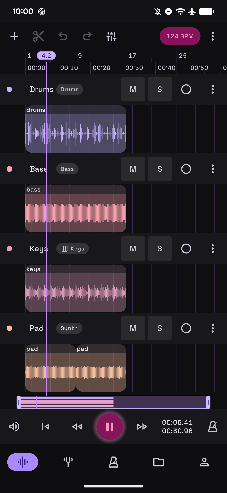
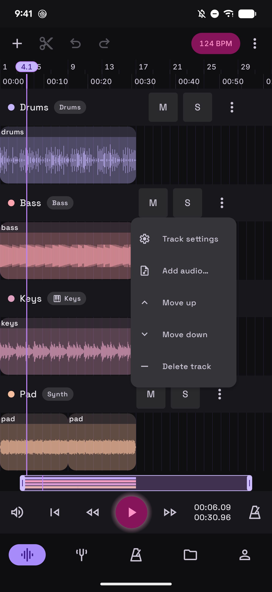
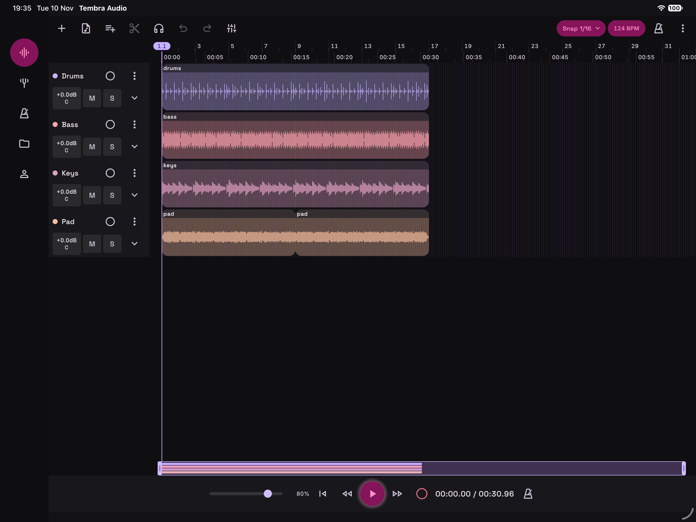
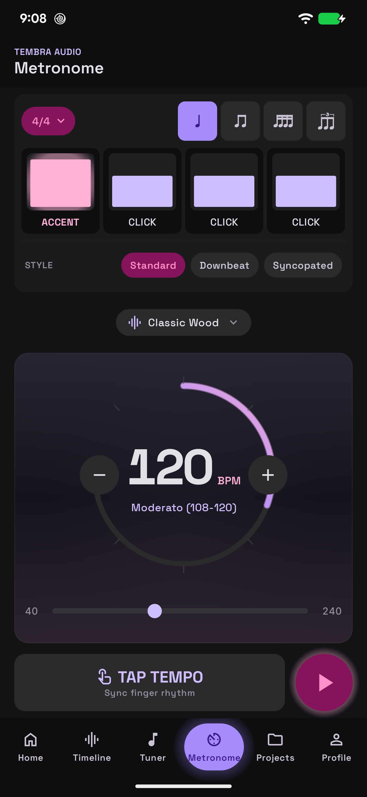
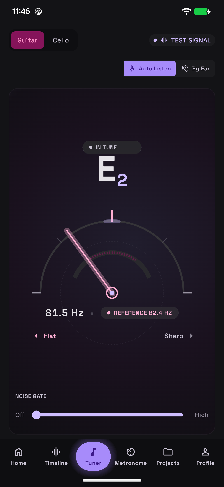
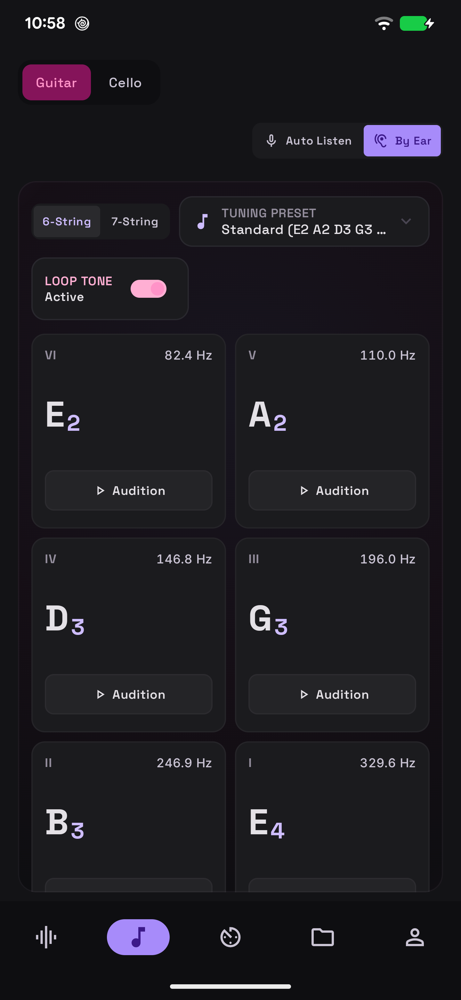
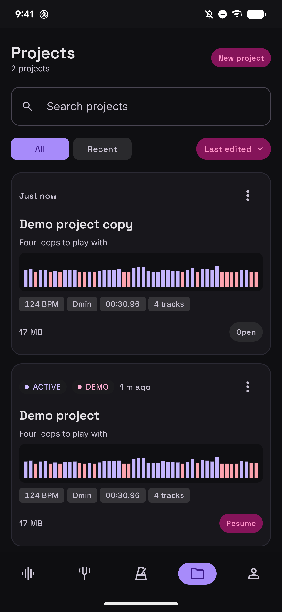

# Tembra Audio

A free, open-source mobile DAW for Android and iOS. One shared C++ real-time audio engine does the
audio work; a Kotlin Multiplatform control plane and a Compose Multiplatform UI run on top of it, so
both platforms share the same DSP and the same screens.

The project is at an early stage. You can use the timeline, the metronome and the tuner today.
Recording, the mixer and effects come next. The app opens on Timeline with the project you had
open last. Profile already appears in the navigation, but for now it only shows a placeholder.

## What works now

### Timeline

Play several tracks of audio clips together, with waveforms, a ruler in bars and time, and a
playhead you can tap or drag to a new position. Import WAV, FLAC and MP3 files onto a track. The app
keeps its own copy of each file in the project. Split, move and delete clips, with undo and redo.
Each track has mute, solo, gain and an instrument label. Zoom by pinching or with the overview strip
above the transport bar, and snap edits to a grid from whole bars down to sixteenth notes. The
metronome can click along at the project's tempo. On first launch the timeline opens a demo project
with four tracks.

<p>
  
  
</p>


### Metronome

Tempo from 40 to 240 BPM via a dial, a slider or tap tempo. Choose the time signature,
subdivisions, the accent for each beat, a click sound, or a WAV file of your own. Playback continues
in the background. The engine schedules each click to the exact sample, so ticks don't drift.



### Tuner

*Auto Listen* detects pitch from the microphone and shows the note, the frequency and how far it is
from the reference pitch. *By Ear* plays reference tones for each string, either once or on a loop.
Guitar (6 or 7 strings, several tuning presets) and cello are supported.

<p>
  
  
</p>

### Projects

A library of your projects with search, filters and sorting. Rename a project, add a description or
a key, duplicate it or delete it. Edits are saved automatically.



### Adaptive layout

Separate layouts for phones (portrait and landscape), tablets and foldables. A foldable in tabletop
or book posture splits the screen at the hinge.

### Desktop windows, mouse and keyboard

On Chromebooks, Android desktop windows and iPad windows the app resizes live without stopping the
audio. Controls show tooltips on hover, right-click opens a clip's or a project's menu, and the
wheel or trackpad scrolls and zooms the timeline. Ctrl+1 to Ctrl+5 (⌘ on iPad) switch screens, and
Ctrl+/ lists every shortcut. Audio files dropped on the timeline or the project list are imported,
and WAV, FLAC and MP3 files open from the Files app as a new project.

## How it is built

```
Compose Multiplatform UI + ViewModels (Kotlin, shared)
        │  commands only
        ▼
AudioEngine facade  ── JNI on Android, cinterop on iOS
        │  lock-free FIFOs and atomics
        ▼
C++ real-time engine (tuner, metronome, clip playback, later mixer and effects)
        │
Oboe (Android) · RemoteIO (iOS)
```

The architecture follows a few fixed rules:

- No Kotlin code runs on the audio thread. The C++ engine owns the real-time callback. Kotlin only
  sends commands and reads telemetry.
- The two platforms share one engine and don't have separate DSP code, so an effect sounds the same on
  Android and iOS.
- Everything musical is stored in beats, which the engine converts to samples through the tempo map.
- The shipped binary includes only permissively licensed code, so GPL libraries such as JUCE and
  Rubber Band are ruled out. Every dependency is listed in
  [`app/THIRD_PARTY_LICENSES.md`](app/THIRD_PARTY_LICENSES.md).

## Build and run

You need macOS with JDK 21, Xcode 26, the Android SDK (platform 37), NDK 29 and CMake 3.31.6. The full
list and the install commands are in [`app/README.md`](app/README.md).

```bash
cd app
echo "sdk.dir=$HOME/Library/Android/sdk" > local.properties

# Android: on a connected device or an emulator
./gradlew :androidApp:installDebug
adb shell am start -n com.tembraaudio/audio.tembra.android.MainActivity

# iOS: open app/iosApp/iosApp.xcodeproj in Xcode and press Run,
# or build from the command line as described in app/README.md
```

Tests:

```bash
./gradlew checkAndroidHost     # JVM unit tests
./gradlew checkIos             # iOS simulator, including Compose UI tests
./gradlew checkAndroidDevice   # connected Android device
./gradlew engineHostTest       # C++ engine tests (Catch2) on the macOS host
```

The build is gated on zero compiler warnings.

## Repository layout

| Folder | Contents |
|--------|----------|
| [`app/`](app) | The application: Gradle root, shared Kotlin modules, the C++ engine, the Android app and the Xcode project. Start at [`app/README.md`](app/README.md) for the module map. |
| [`specs/`](specs) | One folder per feature (spec, plan, tasks, screenshots), produced with [spec-kit](https://github.com/github/spec-kit). |
| [`.specify/`](.specify) | Spec-kit templates and scripts, plus the project [constitution](.specify/memory/constitution.md): the engineering rules every feature follows. |
| [`docs/`](docs) | Research behind the architecture: DAW internals, tuner and metronome algorithms, the license-safe library stack, diagrams. Start at [`docs/README.md`](docs/README.md). |
| [`design/`](design) | Brand assets and the Stitch design system ([`design/stitch/DESIGN.md`](design/stitch/DESIGN.md), `theme.json`). |

## How features get built

Every feature goes through spec-kit: specify, clarify, plan, tasks, implement. The constitution sets
the build order: tuner, metronome, audio playback, transport and timeline, mixer, effects and
automation, recording and loops, then collaboration. To see how a finished feature was decided and
tested, read the folder for that feature in `specs/`.

## License

Tembra Audio is licensed under the [Apache License 2.0](LICENSE). Third-party components keep their own
licenses, which are listed in [`app/THIRD_PARTY_LICENSES.md`](app/THIRD_PARTY_LICENSES.md).
